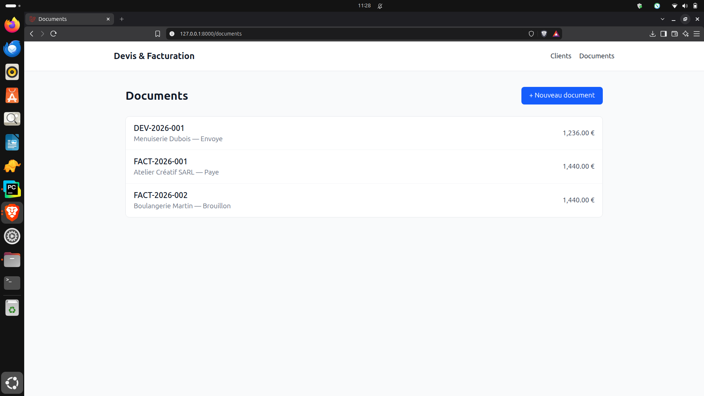
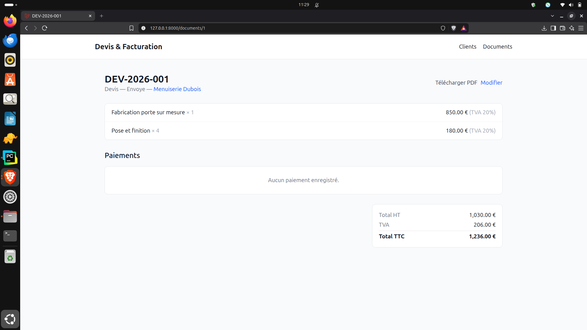
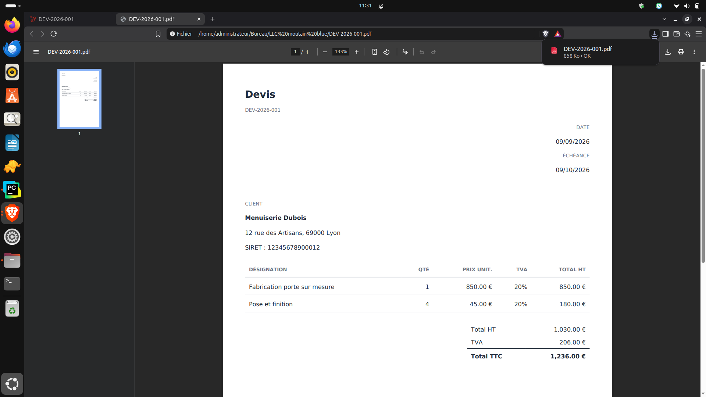

# Invoicing & Quotes

[](https://github.com/Mountainbluesun/devis_facturation/actions/workflows/tests.yml)

🔗 **Live demo:** [devis.jeremylebrun.dev](https://devis.jeremylebrun.dev)

Quote and invoice management application built with Laravel, designed for small businesses and freelancers.

## Use case

A freelancer or small business needs to create quotes, convert them into invoices once accepted, track received payments, and produce compliant PDF documents.

## Features

- Client management (full CRUD)
- Quote creation with multiple line items and automatic subtotal/VAT/total calculation
- One-click quote-to-invoice conversion, with gapless legal sequential numbering
- Status tracking (draft, sent, accepted, paid...)
- Payment recording (partial or full), with automatic "paid" status update
- PDF generation for quotes and invoices
- User authentication (Laravel Breeze)
- Responsive interface (Tailwind CSS)

## Tech stack

- Laravel 13
- Blade + Tailwind CSS
- SQLite
- Laravel Breeze (authentication)
- DomPDF for document generation

## Installation

```bash
git clone https://github.com/Mountainbluesun/devis_facturation
cd devis_facturation
composer install
npm install
cp .env.example .env
php artisan key:generate
touch database/database.sqlite
php artisan migrate
php artisan db:seed --class=DemoSeeder
npm run build
php artisan serve
```
## Running tests

```bash
php artisan test
```

The test suite covers quote totals, document numbering, quote-to-invoice conversion, payments and invoice deletion rules.

Tests run automatically on every push and pull request through GitHub Actions: the workflow installs PHP 8.3 and the dependencies, builds the front-end assets, then runs `php artisan test` (see `.github/workflows/tests.yml`).

## Screenshots

### Document list


### Invoice detail with payments


### Generated invoice PDF


## Security

- **Data isolation:** every client, document and payment belongs to a user. Other users' records return a 404, and this behavior is covered by automated tests.
- **Server patching:** as of October 2026, the production server runs PHP 8.3 with the fix for the critical PHP vulnerabilities CVE-2026-109618 and CVE-2026-109619 ("PHP2Shell"), applied through Ubuntu's patched packages.
- **Demo:** the live demo is for demonstration only. Please do not enter real data.

## Known limitations / roadmap

- No credit notes (cancelling an issued invoice)
- No accounting export

